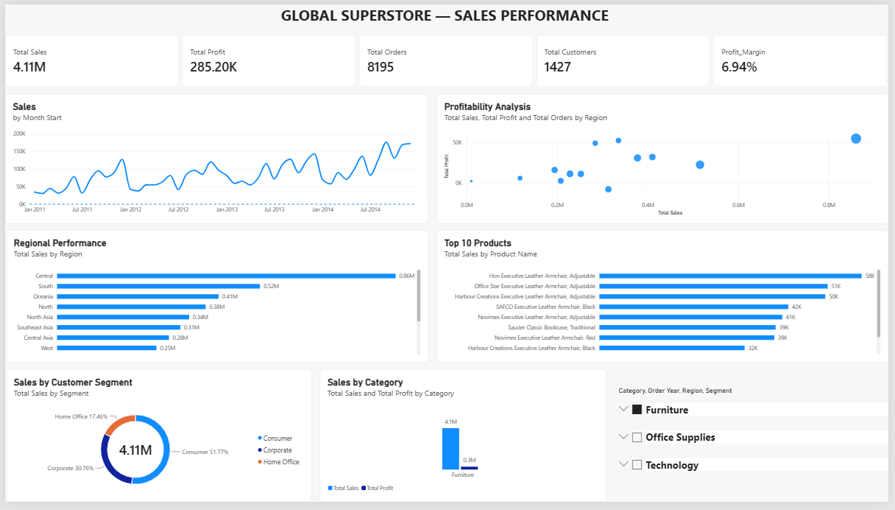

# 🌍 Global Superstore — Sales Performance Analysis

## 📊 Project Overview

Global Superstore Sales Performance Analysis is an end-to-end data analytics project focused on understanding sales, profitability, customer behavior, product performance, and regional trends.

The project uses Python for data cleaning, MySQL for data analysis, and Power BI for interactive visualization.

---

## 🎯 Business Objectives

- Analyze overall sales and profitability
- Identify high-performing and low-performing regions
- Understand category and sub-category performance
- Identify top and bottom-performing products
- Analyze customer segments
- Evaluate the impact of discounts on profitability
- Analyze shipping mode performance
- Identify countries and products generating negative profit
- Track monthly and yearly sales trends

---

## 🛠️ Tools & Technologies

- Python
- Pandas
- MySQL
- SQL
- Power BI
- DAX

---

## 🔄 Project Workflow

Raw Data
↓
Python Data Cleaning
↓
MySQL Data Analysis
↓
Power BI Data Modeling
↓
DAX Measures
↓
Interactive Dashboard
↓
Business Insights

---

## 🐍 Python Data Cleaning

Python and Pandas were used to:

- Inspect the dataset
- Handle missing values
- Identify duplicate records
- Convert data types
- Standardize columns
- Validate numerical fields
- Prepare the cleaned dataset for analysis

---

## 🗄️ SQL Analysis

SQL was used to perform:

- Overall KPI analysis
- Yearly and monthly sales analysis
- Regional analysis
- Country-level analysis
- Category and sub-category analysis
- Product performance analysis
- Customer segment analysis
- Discount and profitability analysis
- Shipping mode analysis

---

## 📈 Power BI Dashboard

The dashboard provides an interactive view of:

- Total Sales
- Total Profit
- Total Orders
- Total Customers
- Profit Margin
- Monthly Sales Trend
- Sales by Region
- Sales by Category
- Top 10 Products
- Sales by Segment
- Sales vs Profit

### Dashboard Preview



---

## 💡 Key Business Insights

### Regional Performance

Central is the highest-sales region, generating approximately $2.82M in sales and $311K in profit.

North Asia generates lower sales than Central but achieves a significantly higher profit margin, demonstrating that higher revenue does not necessarily mean higher profitability.

Southeast Asia has relatively strong sales but a very low profit margin, making it an area that requires further investigation.

### Profitability

The analysis highlights the difference between sales performance and profitability and identifies products, categories, and regions that require closer attention.

### Discount Analysis

Discount levels were analyzed to understand their relationship with profitability and identify high-discount products generating negative profit.

---

## 📂 Repository Structure

```text
Global-Superstore-Sales-Performance/
│
├── output/
│   ├── superstore_cleaned.csv
│   └── superstore_mysql.csv
│
├── power_bi/
│   └── GLOBAL SUPERSTORE — SALES PERFORMANCE.pbix
│
├── python/
│   ├── 01_data_cleaning.py
│   ├── 02_data_quality.py
│   ├── 03_investigate.py
│   ├── 04_data_cleaning.py
│   ├── 05_validate_cleaned_data.py
│   ├── 06_prepare_mysql.py
│   └── 07_import_mysql.py
│
├── screenshots/
│   └── dashboard_GS.png
│
├── sql/
│   └── Global_Superstore_Sales_Analysis.sql
│
├── .gitignore
└── README.md


👤 Author
Suhail Shaik

MCA — Artificial Intelligence

Aspiring Data Analyst
